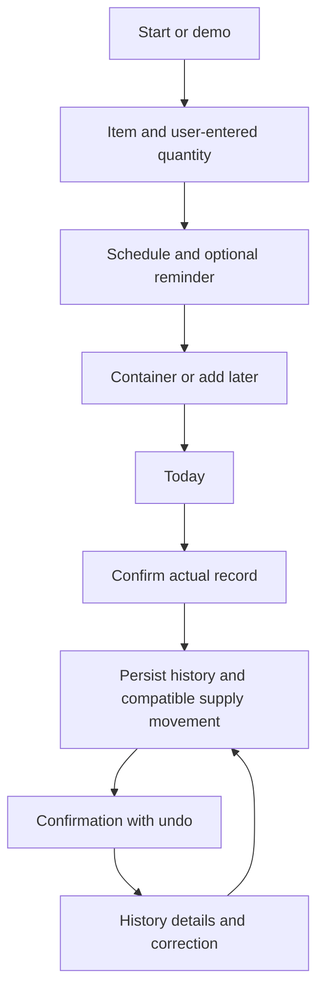

# Screens and interaction flows

Status: UX proposal, not rendered screenshots or implemented app. Labels below are suggested English UI copy. Illustrative values must be labeled demo data and must not appear as prescribed doses.

## Navigation

Four stable bottom tabs: **Today / History / Supply / Progress**. Settings is a top-corner action. Creation is contextual to the relevant tab, avoiding a global menu of unrelated actions.

## First launch

Promise, brief product preview and **Start tracking / Explore demo / Restore backup**. Explain Free/Pro and price before personal setup. Start tracking requires no account. Demo cannot mix synthetic and real records.

Three setup steps: (1) name and user-entered amount/unit; (2) schedule and optional reminder; (3) container or “Add later.” Request notifications after enabling a reminder. Offer backup after the first real record. No compulsory personal-goal questionnaire.

## Today

```text
TODAY                                  Settings
Wednesday, 14 October

UP NEXT
Substance A
User-entered amount · scheduled time
Container: Vial 1
[ Log taken ]                   [ Skip ]

ALSO TODAY
Substance B · scheduled time
[ Log taken ]

RECORDED TODAY
✓ Substance C · actual time
  View entry

SUPPLY
Vial 1 is below your chosen threshold
[ View supply ]

Today       History       Supply       Progress
```

Task hierarchy: today's planned actions, already-recorded events, relevant supply notice. No chart above the recording action. Past unconfirmed times say **Not recorded**, not automatically Missed. Empty day shows **Nothing scheduled today**, next planned event and manual-record action. Paused schedules do not keep generating action demands.

## Record use

Prefill from the selected schedule: item, amount/unit and current container. Actual date/time defaults to now and is editable. Show expected supply usage before save. Site and note are optional.

Primary action: **Save entry**. Confirmation: **Entry saved. Supply updated. Undo.** If no container: **Entry saved. Supply unchanged — no container selected.** A missing compatible usage amount produces similarly explicit feedback.

Changed actual date does not silently shift all future events. Prompt separately for a schedule change if appropriate. Support an additional entry outside any plan.

## History

Default is a date-grouped list; calendar is optional. Each record shows item, amount/unit, actual time, container and status. Filters: item, date range and record type.

Record details expose **Edit entry / Delete entry**, stock effect and correction history. Backdating is directly accessible. Deletion/undo behavior is visible and consistent. Separate a corrected historical record from an effective-dated future plan change.

## Supply

Groups: **In use / Reserve / Finished**. A container card shows name/item, status, recorded remaining amount/unit, last update and “Based on recorded use.”

Container details: initial/current stock, user-entered open/expiry dates, usage/correction transaction list and chosen reminder threshold. Actions: make active, adjust count, mark empty, mark discarded. Changing active container does not rewrite past records.

Display forecast exhaustion separately, with assumptions and missing-data state. Do not present recorded inventory as a physical sensor measurement. Every stock change should have an explainable source.

## Progress and report

**Weight:** chart, numerical list and Add measurement. **Symptoms:** timeline with actual records, severity and notes. “No symptoms” differs from “no observation.” Avoid causal/clinical conclusions from coincident timing.

**Create report:** date range, included sections, summary or detailed diary. Preview what is exported and distinguish blanks from explicit negative observations. PDF is a supporting feature, not an exclusive competitor gap.

## Settings

Reminder permissions and next scheduled notification; backup status and recovery; export; subscription/purchase channel and cancellation; units/display preferences; privacy information; help. Do not hide data export behind cancellation or premium dialogs.

## Visual direction

Restrained adult organizer, system typography, readable numbers, light/dark themes, one action accent and text labels for statuses. Stable task locations, contextual feedback and brief state transitions. Support larger text and VoiceOver. No mascot, compulsory feed or guilt/streak mechanism.

## Main flows to prototype



Material states: first use, demo, empty day, paused plan, awaiting confirmation, skipped event, no container, insufficient/incompatible stock information, local save failure, restore failure, notification denied, expired Pro and export failure. Each needs an explicit recovery path; never show success while persistence failed.
